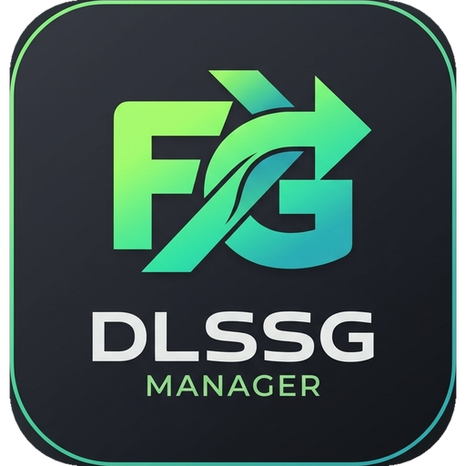
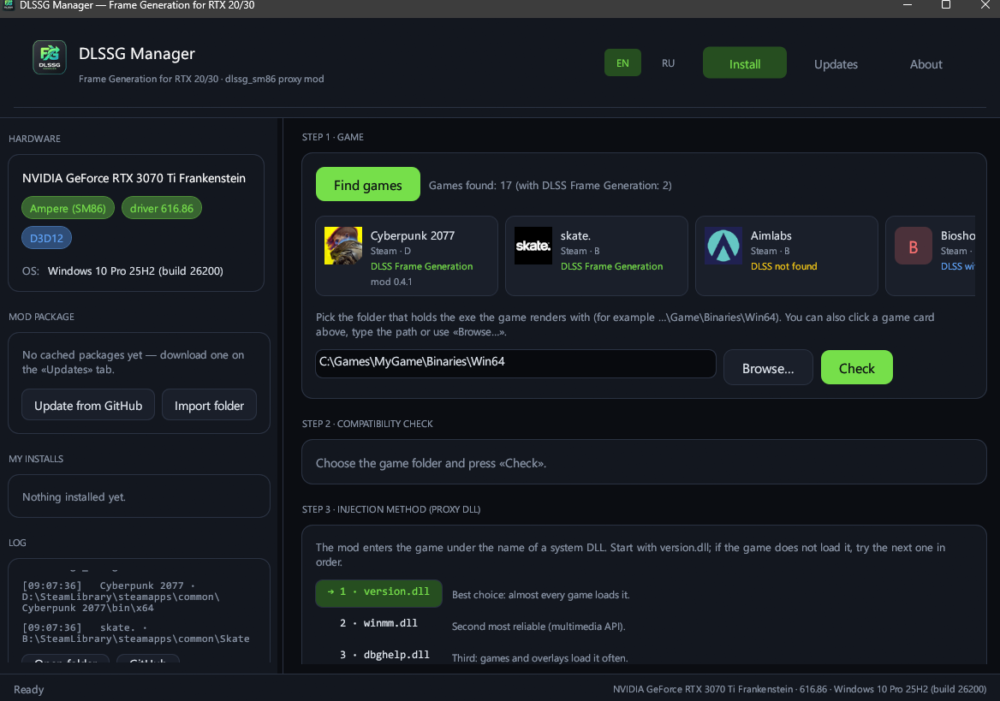
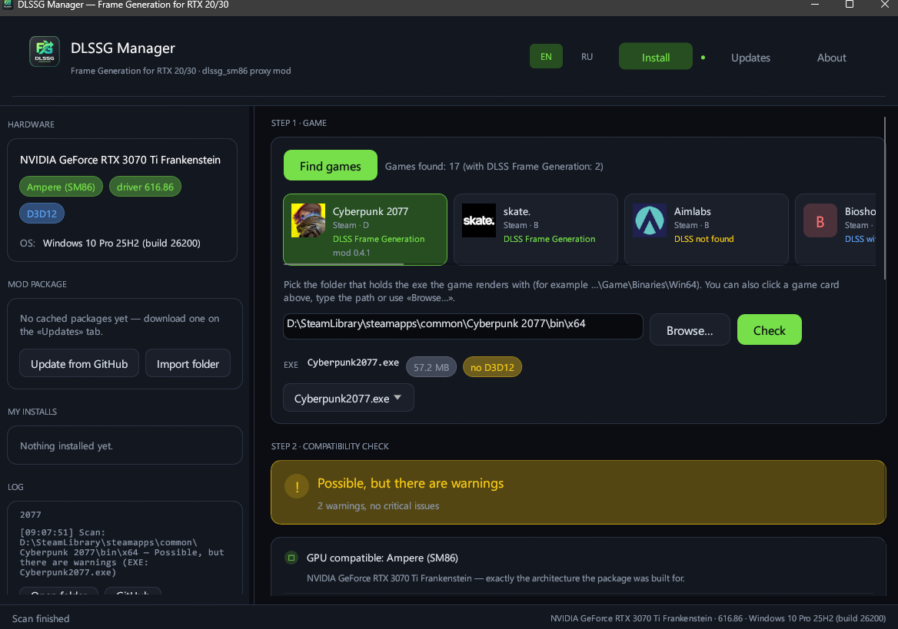
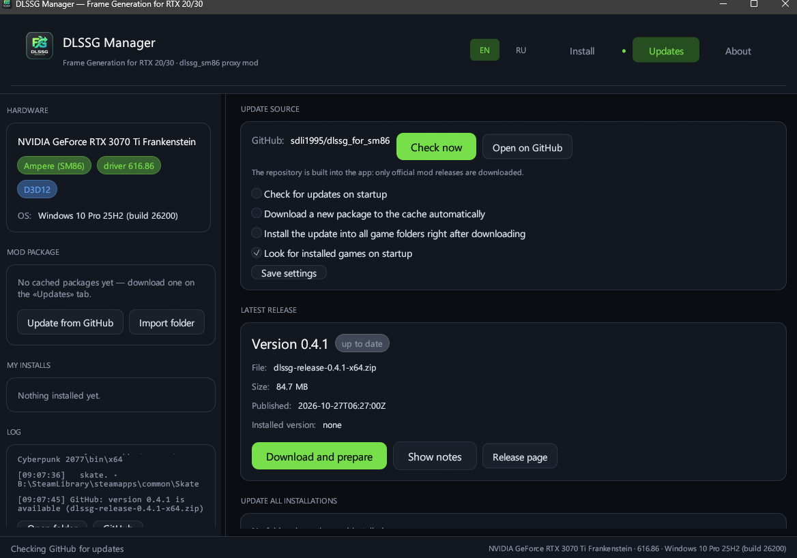
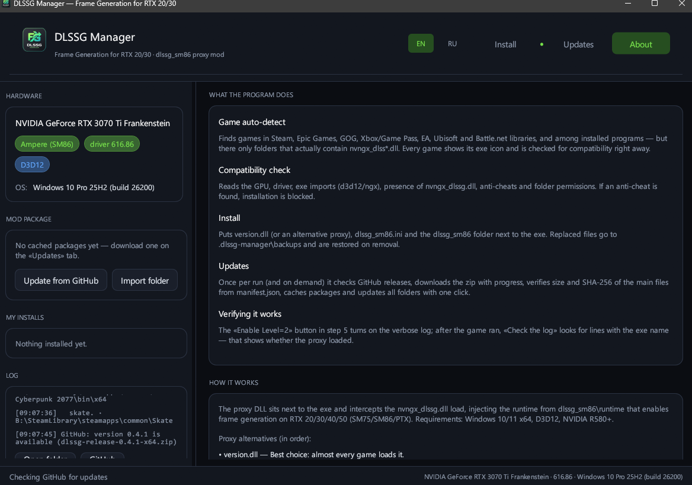

<p align="center">
  
</p>

<h1 align="center">DLSSG Manager</h1>

<p align="center">
  A Windows GUI manager for the
  <a href="https://github.com/sdli1995/dlssg_for_sm86">dlssg_for_sm86</a> proxy mod:
  it finds your games, checks compatibility, installs the mod and keeps it updated.
  <br>
  <sub>Also available in <a href="README.ru.md">Russian</a></sub>
</p>

<p align="center">
  
  
  
</p>

---

## Features

- **Game auto-detection.** Steam (all libraries), Epic Games, GOG, Xbox/Game Pass, EA,
  Ubisoft, Battle.net and the Windows list of installed programs. Each game is shown with its
  own icon, and the app picks the folder that actually contains the renderer exe.
- **Compatibility check.** GPU and architecture, driver version, D3D12 in the exe imports,
  `nvngx_dlssg.dll` presence, anti-cheats, write permissions, running game processes.
- **One-click install.** A proxy DLL (`version.dll`, `winmm.dll`, `dbghelp.dll`,
  `dinput8.dll`, `dxgi.dll`, `d3d12.dll` — in order of reliability), `dlssg_sm86.ini` and the
  `dlssg_sm86` folder. Replaced files go to `.dlssg-manager\backups` and are restored when you
  uninstall.
- **Verify that it works.** Enables the verbose mod log (`Level=2`) and then searches it for
  the game exe name — so you can see whether the proxy actually loaded.
- **Updates.** Checks GitHub releases, downloads the zip with progress, verifies size and
  SHA-256, caches packages and can update every game folder with one button.
- **Russian and English UI** — switch with one click in the header.

## Screenshots

| Install | Game picked and checked |
|---|---|
|  |  |

| Updates | About |
|---|---|
|  |  |

## Requirements

- Windows 10 or 11, x64.
- NVIDIA RTX 20 or 30 series (Turing SM75 / Ampere SM86). RTX 40/50 have native frame
  generation and do not need this mod.
- NVIDIA driver **R580 or newer** — otherwise frame generation will not be enabled.
- A DirectX 12 game with DLSS Frame Generation support.

## Download

1. Grab `DLSSG-Manager-windows-x64.zip` from [Releases](../../releases) and unpack it.
2. Run `DLSSG-Manager.exe`. No installation needed; settings live in
   `%LOCALAPPDATA%\DLSSG Manager`.
3. The exe is not code-signed, so SmartScreen may show “Windows protected your PC” →
   *More info* → *Run anyway*.

## How to use

1. The program looks for games on startup. If yours is missing, press *Browse…* and point it at
   the folder that contains the exe the game renders with
   (for example `...\Game\Binaries\Win64`).
2. Press *Check* and read the verdict and the list of findings.
3. Choose the injection method (default `version.dll`).
4. Press *Install* — the mod files are copied next to the game exe.
5. Launch the game and enable DLSS Frame Generation in the graphics settings. If something does
   not work, step 5 explains how to inspect the mod log.

## How it works

The proxy DLL sits next to the game exe and intercepts the `nvngx_dlssg.dll` load, injecting the
runtime from `dlssg_sm86\runtime`, which enables frame generation on RTX 20/30
(SM75/SM86). This program does not contain the mod: it downloads the author's official
release from GitHub and unpacks it into the game folder.

## Build from source

```powershell
# Rust (rustup) is required; for the exe icon either windres (MinGW) or rc.exe (MSVC)
cargo build --release
# output: target\release\DLSSG-Manager.exe and target\release\dlssgm-cli.exe
```

The icon and version block are embedded by `build.rs` (`assets/app.rc`). If `windres`/`rc.exe` is
not available the build still succeeds — just without an icon.

Regenerate the icon from its source image (`assets/app-source.jpg`):

```powershell
python -m pip install pillow
python tools/make_icon.py
```

Console version:

```powershell
dlssgm-cli games                 # list detected games
dlssgm-cli scan "D:\Game\bin"    # compatibility report for a folder
dlssgm-cli install "D:\Game\bin" version.dll
dlssgm-cli uninstall "D:\Game\bin"
```

## FAQ

**My antivirus / SmartScreen complains about the exe.**
The file is not signed (certificates cost money), and tools that drop a DLL next to a game exe
often trip heuristics. The source is open — you can build it yourself.

**Can I get banned?**
If the game ships an anti-cheat (EasyAntiCheat, BattlEye, Vanguard, …), replacing a DLL may be
treated as tampering. The program detects anti-cheats and blocks installation, but the decision
and the risk are yours. Single-player games without anti-cheat are usually fine.

**My game was not detected.**
Point the app at the folder manually — auto-detection covers launcher libraries and installed
programs, but not every portable/repack build.

**Where do settings, cache and backups live?**
`%LOCALAPPDATA%\DLSSG Manager` (the *App folder* button on the About tab opens it).

**Frame generation does not show up.**
Check: driver R580+, game on DX12, the mod installed into the folder with the renderer exe (not
the game root), and a new DLSS Frame Generation entry in the game settings. The mod log
(`Level=2`) shows whether the proxy loaded.

## Credits

- **App author:** [snappxcxc](https://github.com/snappxcxc) — code, UI, icon.
- **Mod and runtime author:** [sdli1995](https://github.com/sdli1995) —
  [dlssg_for_sm86](https://github.com/sdli1995/dlssg_for_sm86). All mod files (`version.dll`,
  `dlssg_sm86`, `nvngx_*`) belong to them; this program only downloads the official releases and
  unpacks them into game folders.
- **NVIDIA DLSS / nvngx files** are distributed under the NVIDIA license and are not part of this
  repository.

## Legal

- This program is released under the MIT license, “as is”, without any warranty.
- It is **not affiliated with** NVIDIA Corporation and **not endorsed** by it. DLSS, NVIDIA,
  GeForce and RTX are trademarks of NVIDIA Corporation.
- It is **not affiliated with** the mod author sdli1995 and does not claim their work. The mod is
  not bundled: it is downloaded from the author's GitHub releases at runtime.
- Installing the mod modifies game files. You are responsible for that, for possible bans in
  online games and for the integrity of your game installation.

## License

[MIT](LICENSE)
