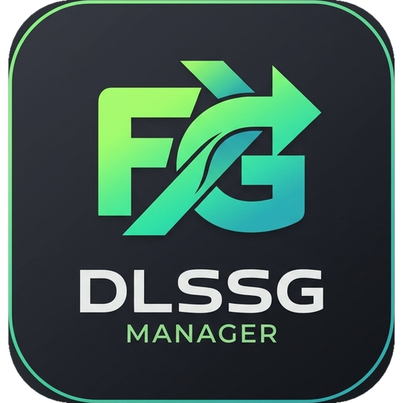
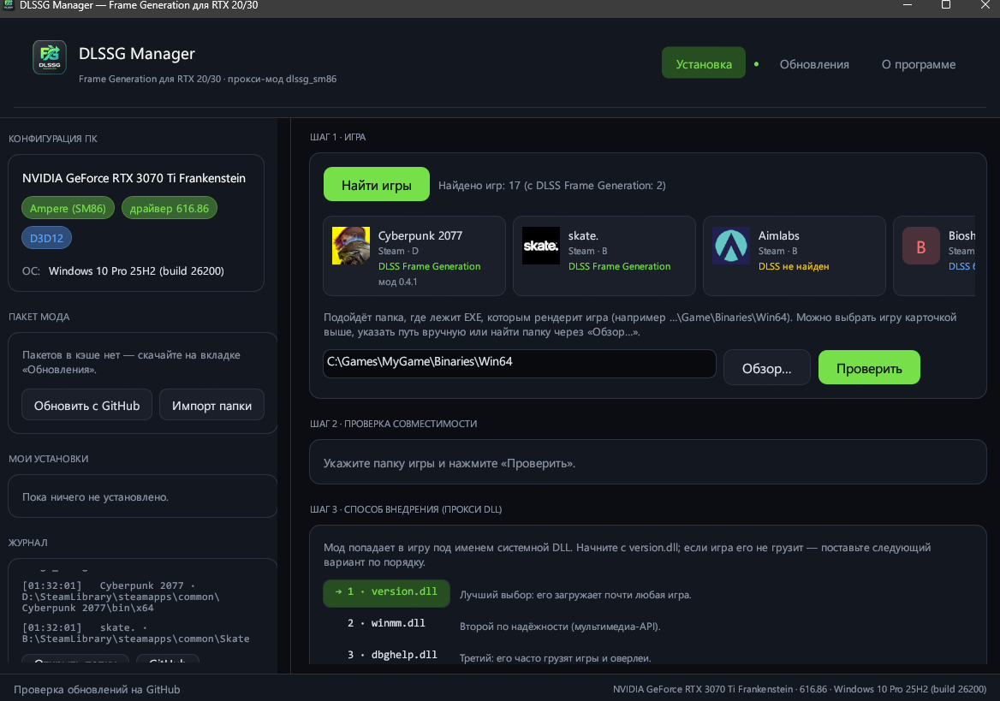
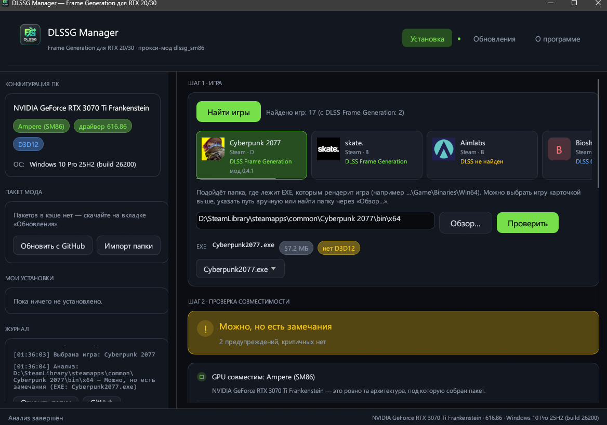
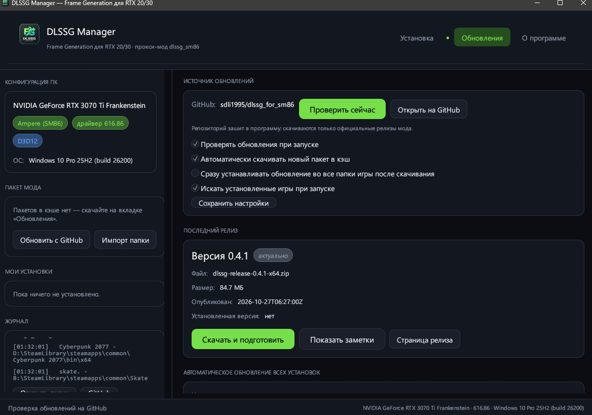
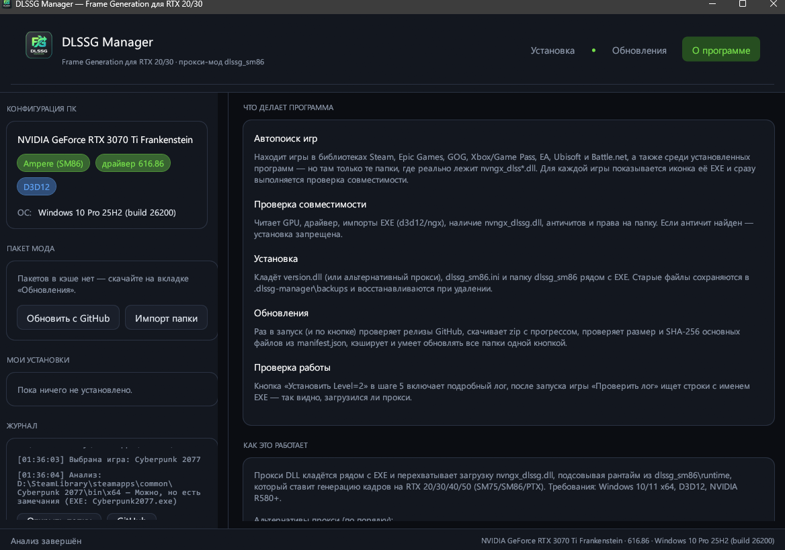

<p align="center">
  
</p>

<h1 align="center">DLSSG Manager</h1>

<p align="center">
  Графический менеджер для прокси-мода
  <a href="https://github.com/sdli1995/dlssg_for_sm86">dlssg_for_sm86</a>:
  сам находит игры, проверяет совместимость, ставит мод и обновляет его с GitHub.
  <br>
  <sub>Есть <a href="README.md">English version</a></sub>
</p>

<p align="center">
  
  
  
</p>

---

## Возможности

- **Автопоиск игр.** Steam (включая несколько библиотек), Epic Games, GOG, Xbox/Game Pass,
  EA, Ubisoft, Battle.net и «Установленные программы» из реестра. У каждой игры показывается
  её иконка, а для каждой папки определяется именно та, где лежит exe рендера.
- **Проверка совместимости.** GPU и архитектура, версия драйвера, D3D12 в импортах exe,
  наличие `nvngx_dlssg.dll`, античиты, права на запись, запущенные процессы игры.
- **Установка в один клик.** Прокси-DLL (`version.dll`, `winmm.dll`, `dbghelp.dll`,
  `dinput8.dll`, `dxgi.dll`, `d3d12.dll` — по порядку надёжности), `dlssg_sm86.ini`
  и папка `dlssg_sm86`. Старые файлы уходят в `.dlssg-manager\backups`
  и восстанавливаются при удалении.
- **Проверка, что мод заработал.** Включает подробный лог (`Level=2`), затем ищет в логе
  строки с именем exe — видно, загрузился ли прокси.
- **Обновления.** Проверка релизов GitHub, скачивание zip с прогрессом, проверка размера и
  SHA-256, кэш пакетов и обновление всех папок игры одной кнопкой.
- **Интерфейс на русском и английском** — переключается одной кнопкой в шапке.

## Скриншоты

| Установка | Проверка игры |
|---|---|
|  |  |

| Обновления | О программе |
|---|---|
|  |  |

## Требования

- Windows 10 или 11, x64.
- Видеокарта NVIDIA RTX (Turing / Ampere / Ada / Blackwell).
- Драйвер NVIDIA **R580 или новее** — иначе генерация кадров не включится.
- Игра на DirectX 12 с поддержкой DLSS Frame Generation.

## Установка

1. Скачайте `DLSSG-Manager-windows-x64.zip` из [Releases](../../releases) и распакуйте.
2. Запустите `DLSSG-Manager.exe`. Устанавливать не нужно, все настройки лежат
   в `%LOCALAPPDATA%\DLSSG Manager`.
3. Exe не подписан сертификатом, поэтому SmartScreen может показать
   «Windows защитила ваш компьютер» → «Подробнее» → «Выполнить всё равно».

## Как пользоваться

1. При запуске программа сама ищет игры. Если нужной нет — «Обзор…» и укажите папку,
   где лежит exe, которым рендерит игра (например `...\Game\Binaries\Win64`).
2. Нажмите «Проверить» и посмотрите вердикт и список замечаний.
3. Выберите способ внедрения (по умолчанию `version.dll`).
4. «Установить» — файлы мода копируются рядом с exe.
5. Запустите игру и включите DLSS Frame Generation в настройках графики.
   Если что-то не так, шаг 5 подскажет, как проверить лог мода.

## Как это работает

Прокси-DLL кладётся рядом с exe и перехватывает загрузку `nvngx_dlssg.dll`, подсовывая
рантайм из `dlssg_sm86\runtime`, который включает генерацию кадров на RTX 20/30/40/50
(SM75/SM86/PTX). Программа сама мод не содержит — она скачивает официальный релиз
автора мода с GitHub и раскладывает файлы по папке игры.

## Сборка из исходников

```powershell
# нужен Rust (rustup) и, для иконки, windres (MinGW) или rc.exe (MSVC)
cargo build --release
# результат: target\release\DLSSG-Manager.exe и target\release\dlssgm-cli.exe
```

Иконка и блок версии вшиваются через `build.rs` (`assets/app.rc`). Если `windres`/`rc.exe`
не найдены, сборка всё равно пройдёт — просто без иконки.

Пересобрать иконку из исходника (`assets/app-source.jpg`):

```powershell
python -m pip install pillow
python tools/make_icon.py
```

Консольная версия:

```powershell
dlssgm-cli games                 # список найденных игр
dlssgm-cli scan "D:\Game\bin"    # проверка совместимости папки
dlssgm-cli install "D:\Game\bin" version.dll
dlssgm-cli uninstall "D:\Game\bin"
```

## Частые вопросы

**Антивирус/SmartScreen ругается на exe.**
Файл не подписан (сертификат стоит денег), плюс программы, которые кладут DLL рядом
с exe игры, часто ловят эвристикой. Исходники открыты — можно собрать самому.

**Это может привести к бану?**
Если рядом с игрой есть античит (EasyAntiCheat, BattlEye, Vanguard и т. п.), подмена DLL
может быть расценена как вмешательство. Программа находит античиты и блокирует установку,
но решение и риск — на вас. В одиночных играх без античитов проблемы маловероятны.

**Игра не нашлась автоматически.**
Укажите папку вручную — поиск покрывает библиотеки лаунчеров и установленные программы,
но не все пиратские/portable сборки.

**Где хранятся настройки, кэш и бэкапы?**
`%LOCALAPPDATA%\DLSSG Manager` (кнопка «Папка программы» на вкладке «О программе»).

**Генерация кадров не включается.**
Проверьте: драйвер R580+, игра на DX12, мод стоит в папке с exe рендера (не в корне игры),
в настройках игры появился пункт DLSS Frame Generation. Лог мода (`Level=2`) покажет,
загрузился ли прокси.

## Авторы и благодарности

- **Автор программы:** [snappxcxc](https://github.com/snappxcxc) — код, интерфейс, иконка.
- **Автор мода и рантайма:** [sdli1995](https://github.com/sdli1995) —
  [dlssg_for_sm86](https://github.com/sdli1995/dlssg_for_sm86). Все файлы мода
  (`version.dll`, `dlssg_sm86`, `nvngx_*`) принадлежат ему; эта программа лишь скачивает
  официальные релизы и раскладывает их по папке игры.
- **NVIDIA DLSS / nvngx-файлы** распространяются по лицензии NVIDIA и в репозиторий не входят.

## Правовая информация

- Программа распространяется по лицензии MIT, «как есть», без каких-либо гарантий.
- Проект **не связан** с NVIDIA Corporation и **не поддерживается** ею.
  DLSS, NVIDIA, GeForce и RTX — товарные знаки NVIDIA Corporation.
- Проект **не связан** с автором мода sdli1995 и не претендует на его работу.
  Мод в репозиторий и релизы не включён: он скачивается с GitHub автора при запуске.
- Установка мода изменяет файлы игры. Ответственность за это, за возможные баны
  в онлайн-играх и за целостность файлов игры лежит на пользователе.

## Лицензия

[MIT](LICENSE)
